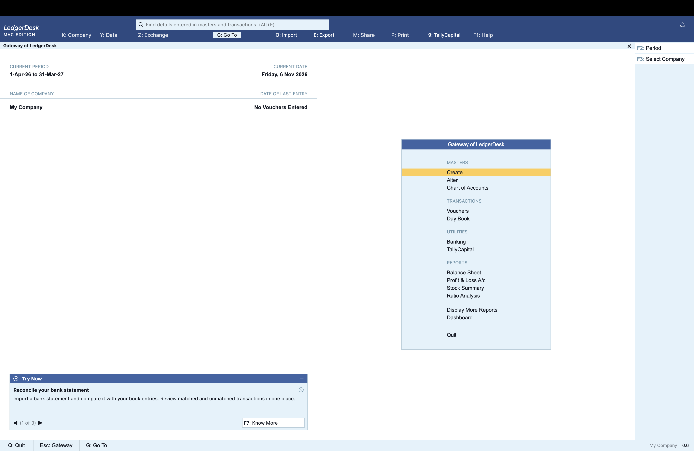
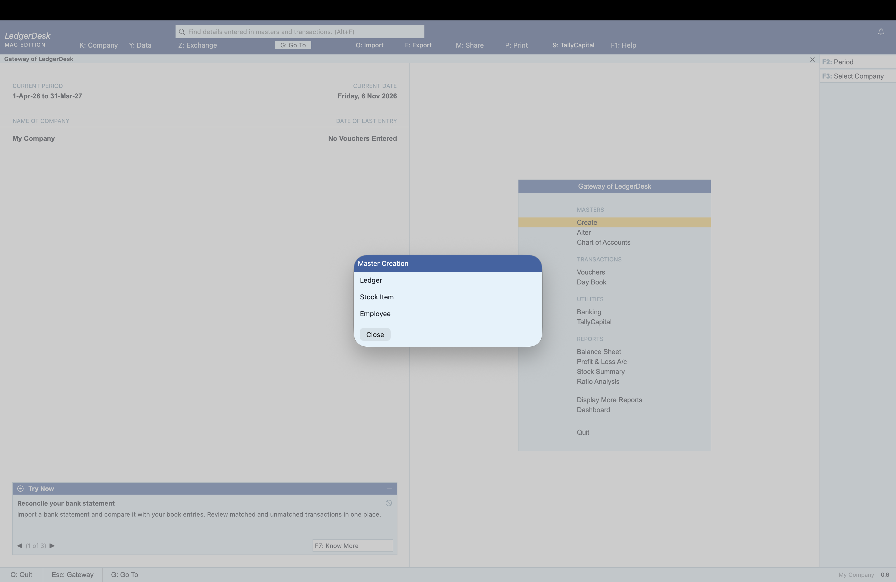
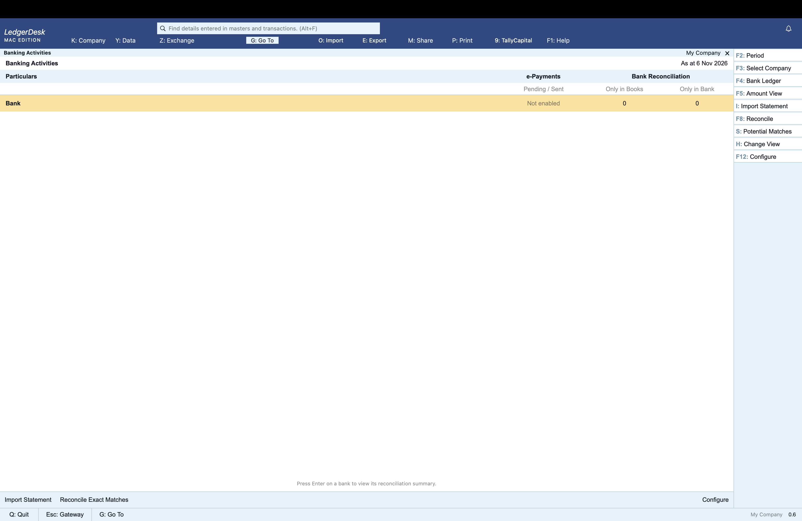
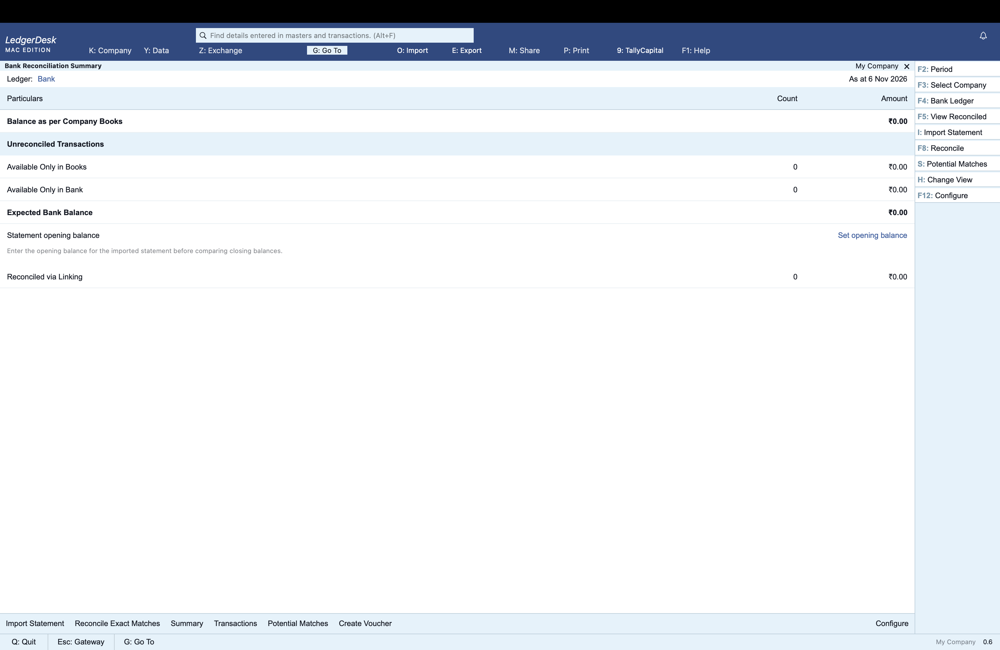
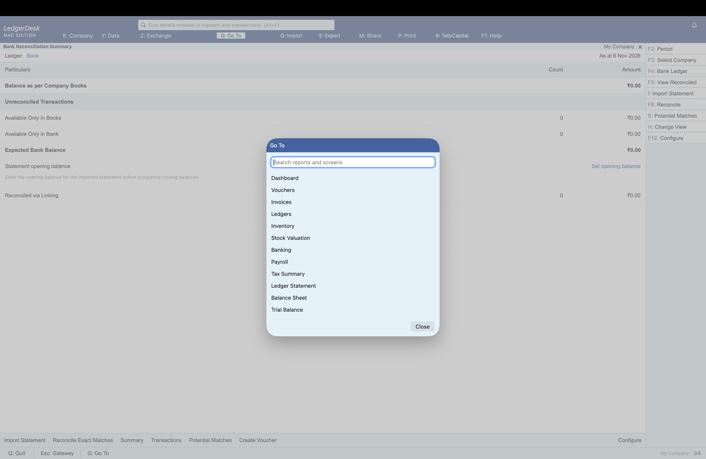

# LedgerDesk for Mac — development build 0.6

Independent offline SwiftUI accounting software for Apple Silicon Macs running macOS 14 or later. This is an ongoing implementation, not a complete TallyPrime replacement or a product of Tally Solutions.

## Screenshots

### Gateway

### Master creation

### Banking activities

### Bank reconciliation

### Go To

## Run and data
Unzip LedgerDesk-Mac.zip and open LedgerDesk.app. The package is locally signed; it is not notarized. Data is stored at ~/Library/Application Support/LedgerDesk/books.json. Company > Export Backup saves a portable JSON backup. Import preserves the previous file as before-import-<UUID>.json in that directory before replacing it. Existing 0.1/0.2 books are decoded with defaults for new fields.

## Features
- TallyPrime-style desktop shell: blue top ribbon, white split Gateway, pale-blue menu and action rail, yellow selection, compact typography and bottom command bar. The standard Mac sidebar has been removed.
- Gateway groups and navigation: Create/Alter/Chart of Accounts; Vouchers/Day Book; Banking; Balance Sheet/P&L/Stock Summary/Ratio Analysis; searchable Go To for all other screens.
- Full-workspace journal and sales/purchase entry, debit/credit or item columns, narration and Accept/Cancel commands. Searchable blue ledger/item lists with keyboard selection.
- F2 date, F3 company, F4 contra, F5 payment, F6 receipt, F7 journal, F8 sales, F9 purchase; arrow/Enter Gateway navigation, Escape to Gateway, Option-G Go To, Ctrl-A Accept.
- Alter supports renaming ledgers while preserving their groups. Ratio Analysis reports assets/liabilities, liabilities/equity and profit/income using posted balances.
- Asset, liability, equity, income and expense ledgers; two-ledger journals; trial balance, balance sheet, income/expense report, and period statements with running balances and CSV export.
- Stock masters, opening quantities, manual receipts/issues, and optional receipt acquisition costs.
- Multiple-line sales and purchase invoices posting accounting and stock in a single atomic save. Invoice review and Print / Save PDF.
- Configurable invoice tax charges with names, percentages and separate input-asset/output-liability ledgers. Use separate CGST/SGST charges or a single IGST charge as appropriate to your configuration. Charges are calculated on the invoice subtotal, rounded separately to paise. Period tax summary shows posted invoice charges.
- Employee monthly basic earnings, allowances and configured deductions. Payroll accrues salary payable and deductions payable against salary expense, stores snapshots and rejects duplicate period posting.
- UTF-8 bank statement CSV import, unique-ID duplicate detection, manual matching/unmatching, unique same-date/signed-amount matching, and unmatched book entries. Ambiguous matches are left unmatched. A transfer voucher can be matched separately for each bank ledger.
- FIFO and moving-average stock valuation through a selected date. Receipts missing a recorded cost use the opening rate and are flagged. Negative historical stock is reported as unavailable instead of silently valued.
- Record validation on load/import, atomic saves for invoices/payroll/banking/stock movements, protected import, and refusal to overwrite books after load failure.

## Typical setup
1. Company: enter your company name and keep an exported backup.
2. Ledgers: add customer/supplier accounts, tax ledgers, salary expense, salary payable and deductions payable as needed.
3. Inventory: create stock items; record receipt quantities and costs or purchase invoices.
4. Invoices: select cash/party and income/expense ledgers, add items and optional named tax charges. Saving posts all accounting and stock effects together.
5. Payroll: add employees, then select the three posting ledgers and a YYYY-MM period. Posting accrues liabilities only; record actual payments using vouchers.
6. Banking: choose the bank asset ledger and import a CSV using the example format. Positive amounts are receipts; negative amounts are payments. Click rows to review manual matches.
7. Review reports and export a backup.

## Bank CSV
Header must be `id,date,description,amount` exactly (case insensitive). IDs must be unique within a bank ledger, dates YYYY-MM-DD, amounts plain signed decimal numbers with up to two decimal places. Quoted fields, commas, escaped quotes and multiline descriptions are supported. The entire import is cancelled for an invalid or duplicate row. This is a normalized interchange format, not support for every bank's native export layout. No online bank connection or money movement occurs.

## Accounting and compliance limits
- Tax charges use user-entered rates and ledger mappings. No automatic supply classification, HSN-based rates, place-of-supply logic, input-credit eligibility, reverse charge, tax returns, e-invoice or e-way bill services. Printed invoices lack the full statutory company/party particulars required for GST invoices. Do not treat them as compliant tax invoices.
- Payroll uses configured amounts only. Attendance, prorating, payslips, PF, ESI, professional tax, TDS and statutory returns are not implemented. Posting does not pay employees.
- Valuation is a separate report. Purchases are expensed to the selected ledger. No automated COGS, opening inventory journal or closing-stock adjustment is posted. Inventory valuation is not automatically incorporated into the P&L or balance sheet. Manual accounting adjustments are required.
- Opening stock is treated as predating all movements. Legacy receipts without stored costs use the opening-rate assumption and are flagged. Backdated sales can pass current-quantity checks but historical negative stock is flagged by valuation.
- Invoice numbers are unique across the company, not separately by financial year. All invoice lines share the configured invoice-level charges; mixed item tax rates and discounts are not implemented.
- Invoice amounts use integer paise and Decimal for tax calculations, but existing vouchers and ledger reports still use Double. This remains a development build requiring independent verification before business use.

## Verification
Two executable core test suites cover invoice posting, tax splits and ledger balances, stock availability, duplicate invoices, invalid amounts, legacy decoding, JSON persistence, backup references, paise rounding, FIFO and moving-average results, date cutoff, payroll accrual/duplicates, quoted CSV, signed matching, unmatching, ambiguous matches, and overall debit/credit balance.

Native UI checks used isolated sample books: verified a ₹100 invoice plus ₹18 tax saved as ₹118; tax summary displayed the posting; the on-disk JSON contained both vouchers and the stock issue; the FIFO/moving-average selector displayed the expected ₹250/₹225 values; payroll displayed ₹12,000 gross, ₹500 deductions and ₹11,500 net; bank matching changed three rows to matched and persisted the matches. Final toolbar/menu additions and the full print/export dialogs have not been checked end to end.

## UI work in 0.4
The shell and Gateway were compared against Tally Solutions' published screenshot: https://resources.tallysolutions.com/wp-content/uploads/2021/08/create-a-company-to-record-transaction-in-tallyprime.png . This is a screenshot reference, not a claim of exact parity with every current TallyPrime release. The original LedgerDesk identity and native macOS window controls are retained. Some configuration dialogs, secondary reports, banking and payroll still use native controls. Company is a single-company details screen; Exchange/Share currently expose backup-file workflows. F4/F5/F6/F7 select labels for the existing two-ledger journal engine, not all specialized Tally voucher rules. The period shown on Gateway is the range of existing posted entries, not a financial-year filter.

UI checks on isolated books verified the Gateway palette/proportions, white ribbon labels, workspace journal and sales entry, searchable ledger selection with Enter, saved journal and sales invoice, Down+Enter navigation to Alter, F8 navigation, Escape return and Ctrl-A invoice acceptance. F1 and single-letter Gateway shortcuts were added after that interaction pass and have compile validation only. No accounting engine changes were made in this UI pass.

## UI work in 0.5 — verified 7.2 reference
Reference: TallyHelp's October 2026 screenshot, explicitly tied to Release 7.2 by its Try Now documentation:
https://help.tallysolutions.com/wp-content/uploads/2026/10/2-try-now-tile-on-gateway-of-tally.png
https://help.tallysolutions.com/try-now-tile-report/

Added the upper SmartFind search row, notifications button, revised two-row ribbon, latest Gateway menu entries, F2 Period/F3 Select Company, current financial-year display, adjusted menu sizing/spacing, and bottom-left Try Now tile. Default window is 1280 × 710, minimum content width 1250, with native macOS window controls. The independent LedgerDesk name remains.

SmartFind searches local ledgers, stock items, journal narrations and invoices by text or displayed amount. It is a case-insensitive substring search, not Tally's cross-company/fuzzy search. Invoice results drill down to their invoice; other results navigate to the related register.

Try Now has working next/previous buttons, minimisation, message hiding, a feature report and a display-settings toggle. Messages describe implemented LedgerDesk features, not Tally connected services. TallyCapital opens an explicit external-service information panel; it is not connected. The Help menu provides an external TallyIra documentation link, not a plug-in installer.

Period selection updates Gateway context only. Individual reports retain their existing scope/date controls; there is no global financial-year filter. Select Company currently shows the single local company. The notifications button displays existing storage errors or No notifications; it is not a remote notification service.

Native UI verification covered normal typed search plus Enter, search results and invoice drill-down, the period dialog, company selector, tile message navigation and minimisation, and final Gateway/ribbon readability. A focus conflict between search input and Gateway shortcuts and blank row hit areas were found and corrected during testing. Final TallyCapital column received a small spacing adjustment after the interaction pass. Accounting engine code was unchanged.

## Banking and document work in 0.6
The screenshot supplied by the user showed an unfinished Banking screen. Banking now opens directly into Banking Activities, listing known bank ledgers even with zero transactions. It has count/amount views, drill-down into Bank Reconciliation Summary and sectioned transaction reports, bank configuration and account metadata, period/as-at selection, contextual F4/F5/F8/F12 actions, matched/unmatched views, same-amount potential-match suggestions within 30 days, and a dedicated Find Matches panel. Creating a missing voucher from an imported bank entry posts and links it in a single atomic transaction. Explicit bank mappings and bank names/references identify bank ledgers; arbitrary asset ledgers are no longer listed automatically.

Closing statement balances remain unknown until the user configures a statement opening balance. With an opening balance, the report uses it plus imported transactions; users must supply a complete statement sequence. Expected bank balance adjusts book balance for unlinked book and bank movements. Calculations use Decimal paise totals. Detailed transaction dates are filtered by the report period; balances are cumulative through the as-at date. Matching remains one-to-one and amount-exact; potential matches are suggestions requiring review. Many-to-many, partial matching, instrument/party rules and tolerance configuration are not implemented. e-Payments is explicitly Not enabled; there is no online banking connection or payment submission.

Added purchase orders with supplier, items, delivery date, status and printing. Orders do not post accounting or stock, and closing is manual; no order-to-receipt fulfillment exists. Added independent invoice/order templates with Classic, Clean and Letterhead styles, colours, fonts, header/footer text, print wrapping and auto-save. These are original local templates, not reproductions of Tally's full template catalogue. Printing uses macOS Print / Save PDF; export/share configuration parity and advanced page layout remain outstanding.

Verification: empty-books Banking showed the existing Bank ledger with 0 counts rather than the old Select a bank placeholder. Populated books showed ₹70 book balance, ₹80 expected/imported balance and ₹0 difference. Creating the missing ₹20 voucher removed the bank-only item and persisted its link. Purchase-order preview, status change, template auto-save and creation of a new ₹225 order were exercised in native UI with isolated books. On-disk writes were checked. All three core suites cover invoice/tax/payroll/inventory regressions plus bank summaries, historical cutoffs, potential matches, schema migration and purchase-order non-posting behavior. The physical printer/PDF save flow and online services were not exercised.

See LATEST-FEATURES.md for the current implementation status against official 7.2/7.1/7.0 release notes.

## Remaining scope
Exact TallyPrime visual/keyboard parity; multiple companies and financial years; multi-line accounting journals; receivable/payment allocation; sales orders, returns and credit notes; statutory tax/payroll services; connected banking; FIFO/average accounting integration, locations, batches, manufacturing and other valuation methods; security roles, audit logs, encryption, multi-user synchronization; full Tally data/API compatibility; exhaustive business reconciliation testing and notarized distribution.

## Build and tests
Requires Xcode command-line tools. `./build.sh` creates a locally signed Apple Silicon app archive at build/LedgerDesk-Mac.zip. `./test.sh` runs all three core suites. `QA` compilation uses isolated sample data at /private/tmp/ledgerdesk-qa-books; release builds use the normal Application Support path. Optional LEDGERDESK_DATA_DIR overrides the data directory for developer testing.

## References consulted
- Tally inventory valuation: https://help.tallysolutions.com/stock-valuation-methods-tallyprime/
- Tally bank reconciliation: https://help.tallysolutions.com/bank-reconciliation-tally/
- CBIC invoice particulars: https://cbic-gst.gov.in/gst-invoice-rules.html
These references inform scope; they do not certify the implementation.
